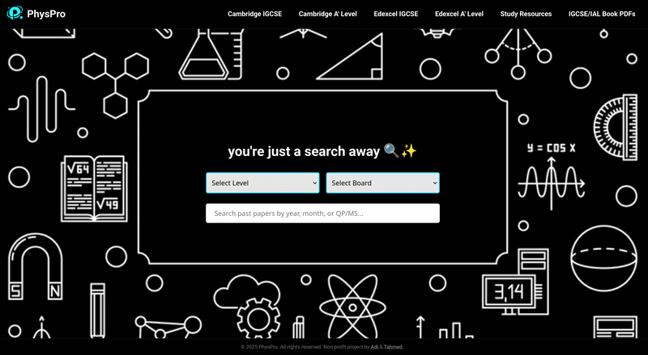

# PhysPro

A free resource hub for IGCSE and A-Level physics students. Search past papers by level, exam board, year and month, and find study resources in one place.

**Live site:** https://physpro.netlify.app



## Features
- Past paper search by level, board, year, month, and QP/MS (question paper / mark scheme)
- Boards covered: Cambridge IGCSE, Cambridge A Level, Edexcel IGCSE, Edexcel A Level
- Study resources and IGCSE/IAL book PDFs
- Designed to work on phones and desktops
- [Add anything else it does, e.g. dark mode, bookmarks, offline use]

## Tech stack
HTML, CSS, JavaScript, JSON data, deployed on Netlify.

## Run locally
```bash
git clone https://github.com/sra1st/PhysPro.git
cd PhysPro
```
Open `index.html` in a browser. [Or use a local server if needed: `npx serve`.]

## About
Non-profit project, built by Adi and Tahmed. 

## Author
adi
